# Clothing Shop Application (`clothing_shop`)

A cross-platform **Clothing Shop** mobile application built with **Flutter**, **Dart**, and **Firebase**. The app provides a complete shopping experience for customers along with a dedicated management dashboard for the shop administrator.

---

## Overview & User Roles

The application supports **two main user roles** with role-based access:

1. **User (Customer)**
   - Starts from the **Welcome / Home** flow and can log in with an existing account or create a new account via **Sign Up / Registration** (registration is strictly for regular users; admin accounts are pre-configured).
   - Browse all available clothing items from the **User Home** screen.
   - Add items to the cart, view the cart, and buy/checkout clothing items.
   - Create and manage a **User Profile**.
   - View **Clothing Shop About** details (description, address, email, contact number, and social media links).
   - Submit **Feedback**.

2. **Admin (Store Manager)**
   - Logs in using a pre-existing admin account and accesses the **Admin Home / Dashboard**.
   - **Insert, Update, and Delete** clothing items (product catalog management).
   - Create and update **Clothing Shop About** information:
     - Shop description
     - Address
     - Email address
     - Contact number
     - Social media accounts / links

---

## Key Features

- **Authentication & Role Routing:** Welcome screen, Login, User Sign-Up, and separate Admin vs. User experiences.
- **Product Catalog Management (Admin):** Add new clothing items, edit existing item details, and remove items.
- **Shopping & Cart Flow (User):** Explore clothing items, add to cart, review cart items, and purchase.
- **Shop Info & Social Presence:** Centralized **About Us** section managed by the admin and viewable by users.
- **User Profile & Feedback:** Personal profile setup and customer feedback submission.

---

## Screenshots

### 1. Welcome & Authentication
| Welcome Screen | Login Screen | Register Screen |
| :---: | :---: | :---: |
| 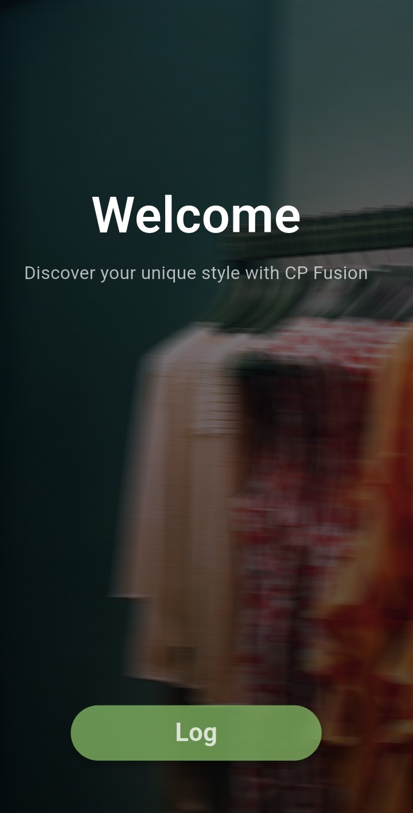 | 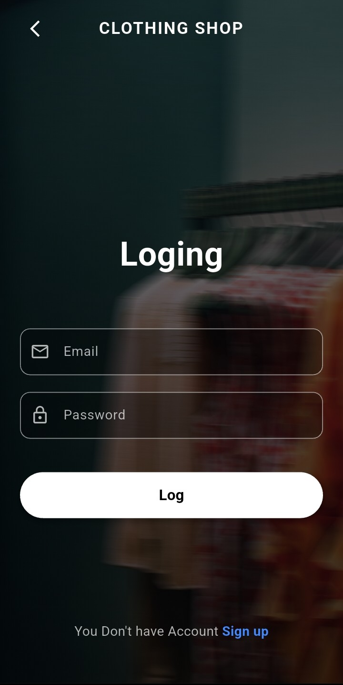 | 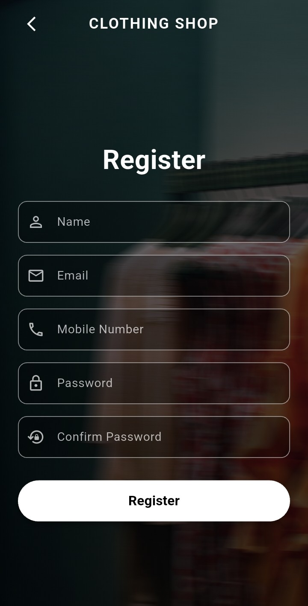 |

<br>

### 2. User Shopping & Profile
| User Home | Item Details | Add to Cart |
| :---: | :---: | :---: |
| 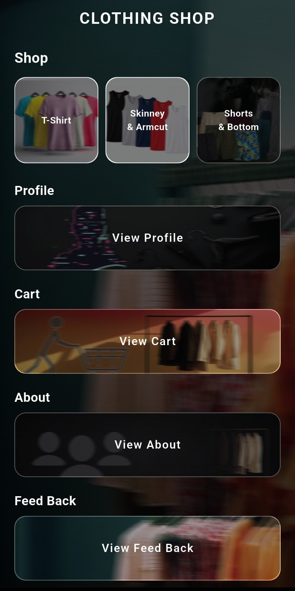 | 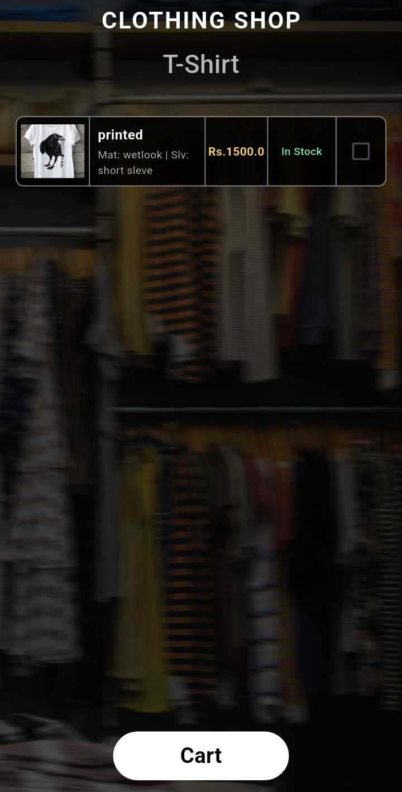 | 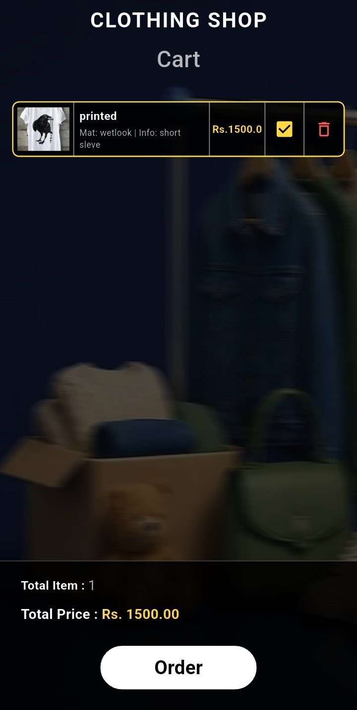 |

| Shop About (User View) | User Profile | Edit Profile |
| :---: | :---: | :---: |
| 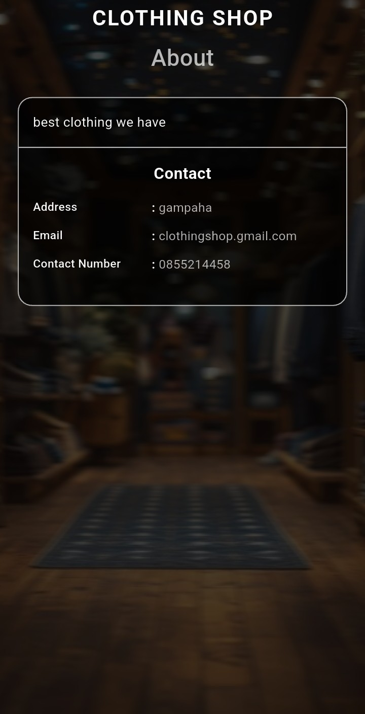 | 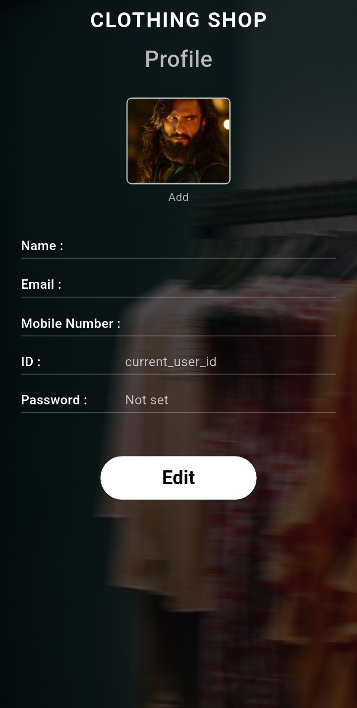 | 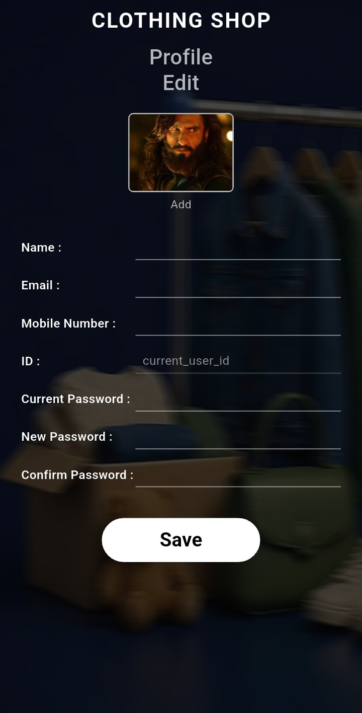 |

<br>

### 3. Admin Management & Feedback
| Admin Dashboard | Add Clothing Item | Update Clothing Item |
| :---: | :---: | :---: |
| 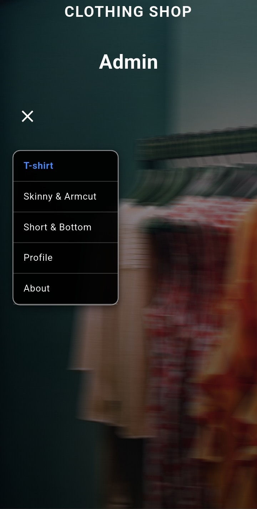 | 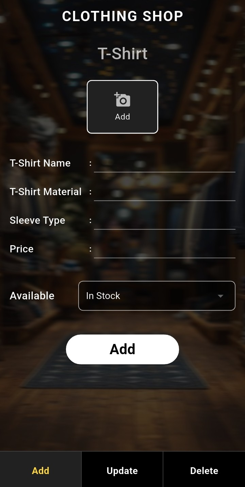 | 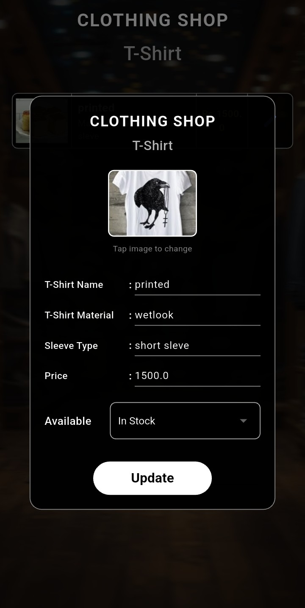 |

| Delete Clothing Item | Shop About (Admin) | User Feedback |
| :---: | :---: | :---: |
| 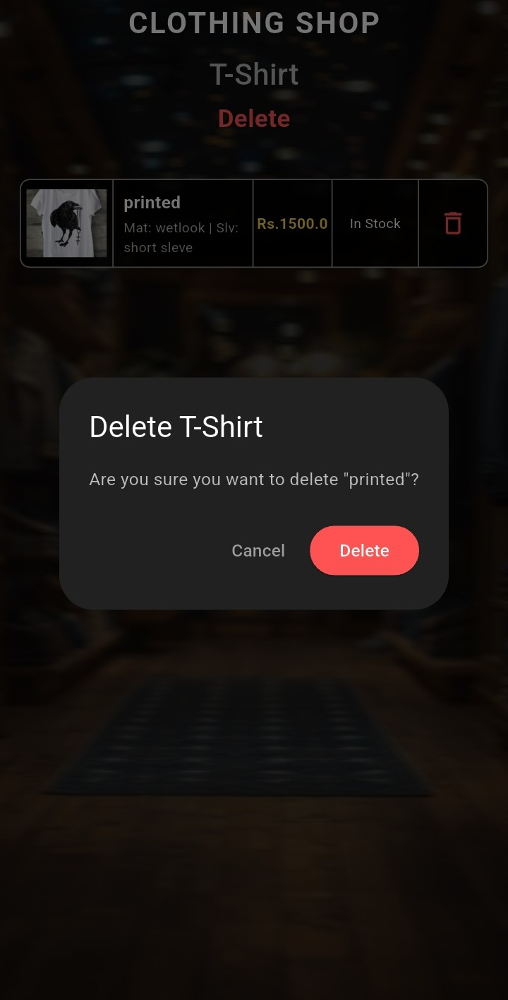 | 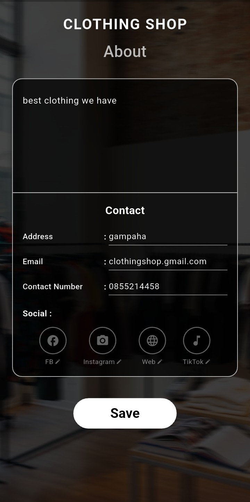 | 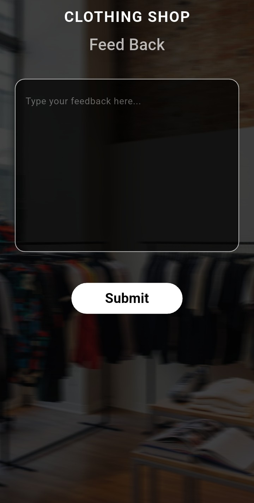 |


## Tech Stack

- **Framework:** Flutter
- **Language:** Dart
- **Backend & Services:** Firebase (Authentication, Cloud Database / Storage as configured in the project)

---

## Getting Started

### Prerequisites
- [Flutter SDK](https://docs.flutter.dev/get-started/install) installed and configured
- A code editor such as [VS Code](https://code.visualstudio.com/) or [Android Studio](https://developer.android.com/studio)
- A configured **Firebase** project (if connecting your own Firebase instance)

### Installation & Running the App

1. **Clone the repository**
   ```bash
   git clone [https://github.com/YOUR-USERNAME/clothing_shop.git](https://github.com/YOUR-USERNAME/clothing_shop.git)
   cd clothing_shop
